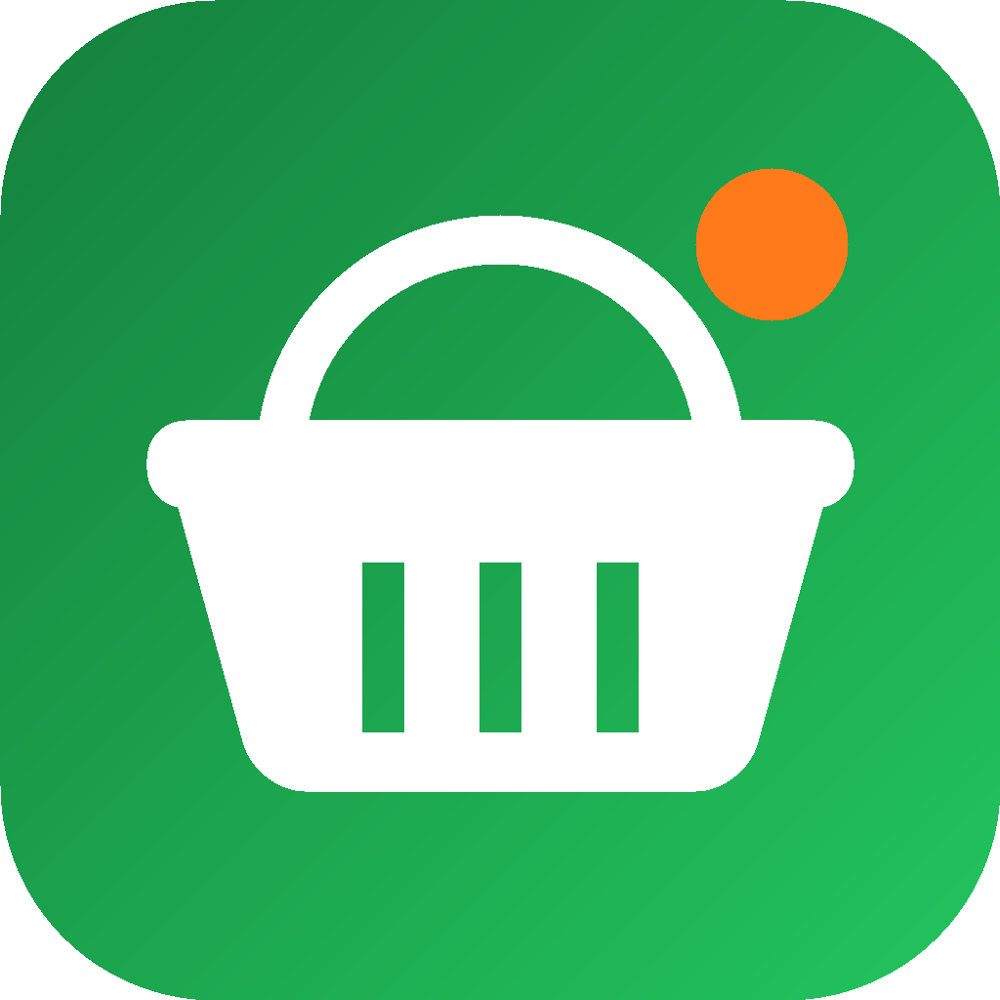
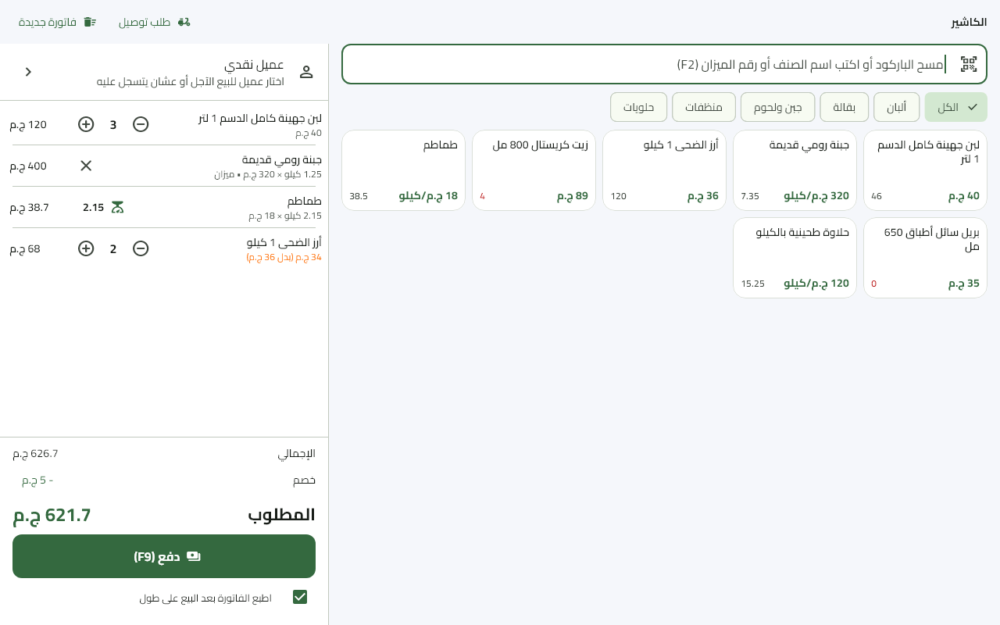
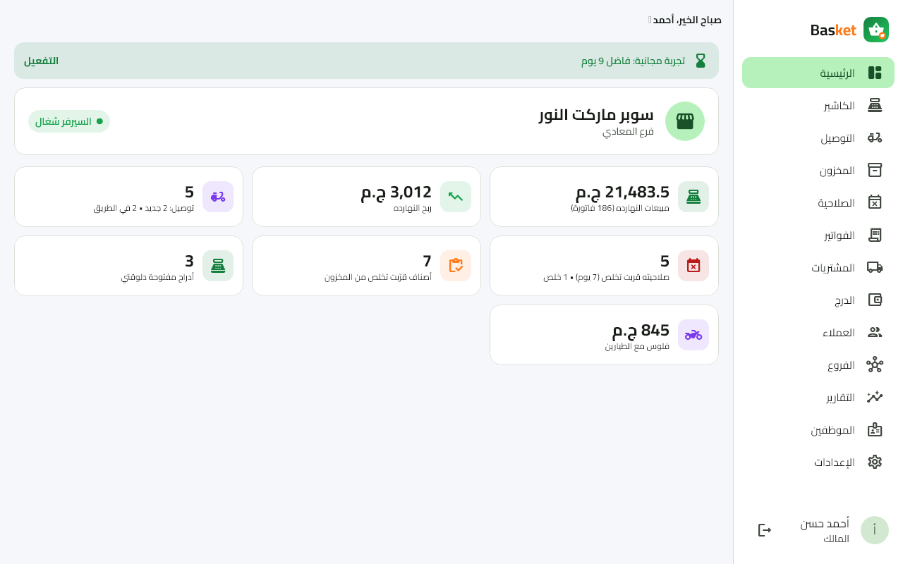
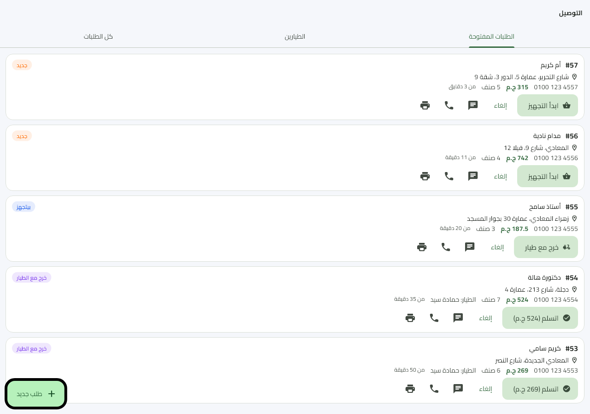
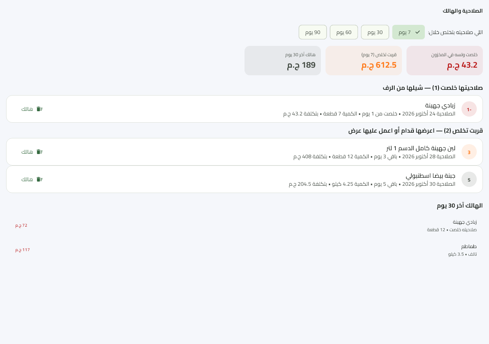
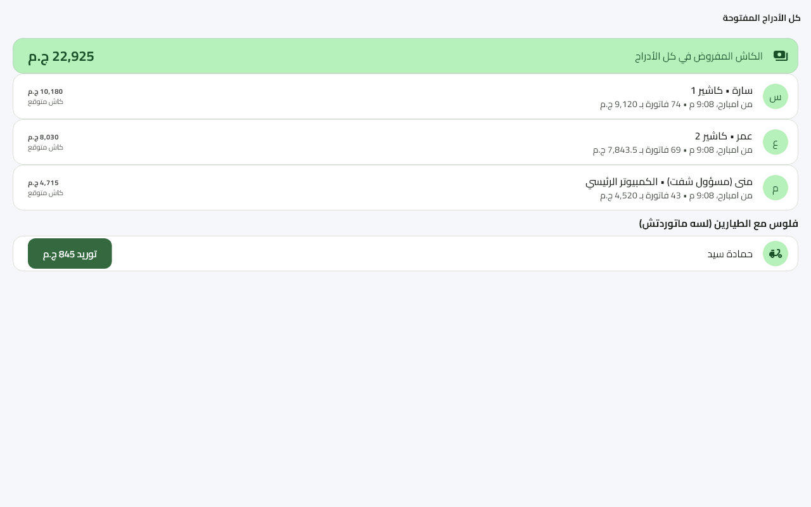
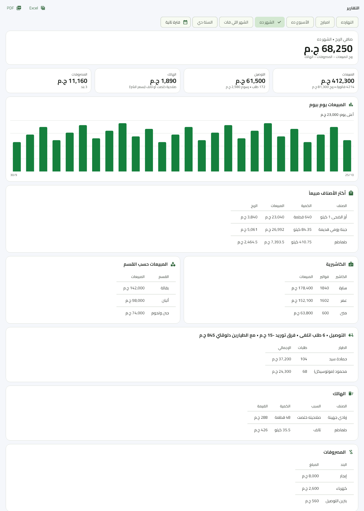
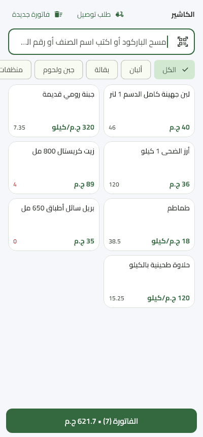
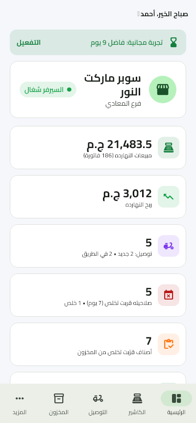
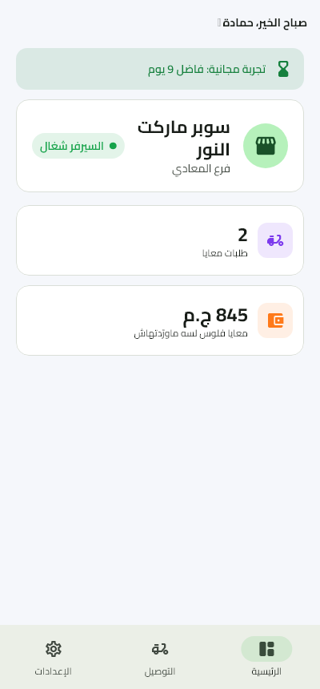

<div align="center">



# Basket

**Supermarket & grocery POS and management — Windows + Android, offline-first**

نظام كاشير وإدارة للسوبر ماركت والبقالة: كاشير بالباركود والميزان + صلاحية + كذا كاشير + توصيل + تقارير + فروع


</div>

<p align="center">
  
</p>

## What is it?

Basket is a point of sale and back office for supermarkets of every size, from a small grocery shop to a
large supermarket selling sweets, dairy, rice and groceries. It is built on the FixTrack code base and keeps
its cashier, stock, suppliers, reports, branches, users, backups and licensing, and adds what a supermarket
needs: **items sold by weight with scale barcodes**, **expiry dates sold first-expiring-first**,
**several cashiers selling at once, each with their own drawer**, and **phone/WhatsApp delivery orders**.

The shop's Windows PC is the server: it runs a local HTTP server inside the desktop app, and every
cashier PC and Android phone connects to it over the shop's Wi-Fi. Everything keeps working without internet.
The cloud (Firebase) is used only to link branches.

## Features

| Area | What it does |
|---|---|
| **Cashier** | Barcode scanning (USB scanner or phone camera), search by name or scale number, sales invoices & returns, discounts, customer credit & collection, receipts on 80/58 mm thermal printers or A4/A5 |
| **Scales & weight** | Items sold by the piece or by the kilo; quantities stored in thousandths (grams) as integers; reads the EAN-13 labels a scale prints (prefix `2x` + PLU + weight **or** price) with a configurable layout and a live example in settings |
| **Expiry dates** | Every delivery of an expiry-tracked item is a batch with its date; sales take the batch that expires first (FEFO) and returns go back to the same batch; near-expiry alert (configurable days); write off expired or damaged stock; waste report |
| **Several cashiers** | Each cashier has their own drawer and shift (opening float, sales, expenses, close & count); the owner/supervisor sees every open drawer and can close any of them |
| **Delivery orders** | Phone/WhatsApp orders with the customer's address (remembered for next time); new → preparing → out with a driver → delivered / cancelled; drivers as staff with the app on their phone or as names only; the cash each driver collects is settled into the receiving cashier's drawer, with shortages recorded |
| **Inventory & purchases** | Products, stock moves, stock counts, suppliers, purchase invoices with expiry per line, barcode labels, **Excel/CSV import with column mapping** (incl. unit and scale number) |
| **Reports** | Owner dashboard; sales, profit, cashiers, categories, delivery, waste and expenses with Excel and PDF export |
| **Branches** | Link branches through Firestore: day summaries, cross-branch stock lookup and transfers (expiry dates travel with the goods) |
| **Users & security** | Roles (owner, shift supervisor, cashier, delivery driver), audit log, daily zip backups + restore |
| **Licensing** | Ed25519-signed offline activation codes, 14-day trial (5 devices), device limit, clock-tamper check |

## Screenshots

| Dashboard | Delivery orders | Expiry & waste |
|---|---|---|
|  |  |  |

| All open drawers | Reports | Scale settings (phone, dark) |
|---|---|---|
|  |  |  |

<p align="center">
  
  &nbsp;
  
  &nbsp;
  
</p>

## Architecture

```
            ┌───────────────────── Shop (LAN, works offline) ─────────────────────┐
            │                                                                     │
  Cashier ──┼──► Windows PC: Basket desktop app                                   │
  PCs and   │      ├─ Flutter UI                                                  │
  Android   │      └─ shelf HTTP server (isolate) ── SQLite ── daily zip backups  │
  phones    │                                                                     │
  (Wi-Fi)   └───────────────┬─────────────────────────────────────────────────────┘
                            │ only when online
                            ▼
                Firebase (Firestore): branch linking
```

- **Flutter 3.47** single codebase, **Riverpod 3** state management
- **shelf** server running in a background isolate, raw **sqlite3** with `user_version` migrations
- Money in piasters and quantities in thousandths, both as integers — no floating point in any total
- Own lightweight XLSX reader/writer and PDF export, ESC/POS printing
- Bundled fonts and assets (no runtime downloads) so it runs on old/low-end devices

## Project layout

```
source/                 the Basket app (Windows + Android)
  lib/src/server/       local API server, database, auth, licensing
  lib/src/features/     screens: pos, delivery, inventory & expiry, purchases, cash drawers, reports, branches…
  installer/            Inno Setup script (Windows installer)
  test/                 57 server/API tests (scale sales, FEFO & expiry, two cashiers, delivery to settlement…)
  test_visual/          screenshot tests (images above)
license-maker/          owner-only tool that signs activation codes (needs the private key, not in this repo)
```

## Build & run

```bash
cd source
flutter pub get
flutter run -d windows        # desktop app (also the shop server)
flutter test                  # 57 tests
flutter build apk --release   # Android app
```

The Windows installer and APKs are built with `source/tool/build_release.ps1` (Inno Setup) into `builds/`.
Signing keys (`android/key.properties`, keystore, `license-private.key`) are intentionally **not** in the repository.
Branch linking currently uses the FixTrack Firebase project (`source/lib/src/core/firebase_config.dart`); its
Firestore rules are deployed from the FixTrack repository.

---

## بالعربي

**Basket** برنامج كاشير وإدارة للسوبر ماركت والبقالة، من المحل الصغير لحد السوبر ماركت الكبير، شغال على **ويندوز وأندرويد**:

- **الكاشير:** بيع بالباركود (سكانر أو كاميرا الموبايل)، والمرتجع، والخصم، والبيع الآجل وتحصيله.
- **الميزان:** الصنف يتباع بالقطعة أو بالكيلو، والبرنامج بيقرا باركود الميزان (الوزن أو السعر جواه) وشكله بيتظبط من الإعدادات.
- **الصلاحية:** كل دخلة بضاعة بتاريخها، والبيع بيسحب من اللي هيخلص الأول، وتنبيه قبل ما الصلاحية تخلص، وتسجيل الهالك وتقريره.
- **كذا كاشير:** كل كاشير بدرجه ووريته، وصاحب المحل ومسؤول الشفت شايفين كل الأدراج المفتوحة وبيقفلوها.
- **التوصيل:** طلبات التليفون والواتساب بالعنوان، ومراحل الطلب لحد التسليم، والطيار يشتغل من موبايله، وتوريد فلوس الطيار في الدرج.
- **المخزون والتقارير والفروع:** الموردين وفواتير الشرا، ونقل الأصناف من البرنامج القديم بملف Excel، وتقارير بتتصدر Excel أو PDF، وربط بين الفروع.

كمبيوتر المحل هو السيرفر، والكاشيرات والموبايلات بتتصل بيه على نفس الواي فاي، فالبرنامج **شغال من غير إنترنت**.
